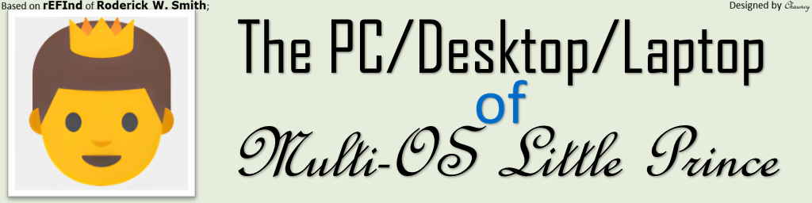
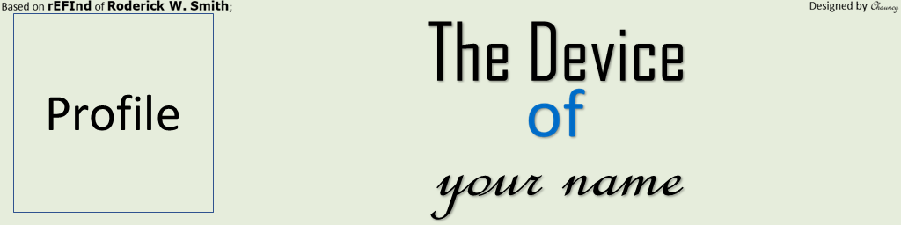

[icons](https://github.com/M-L-P/icons)|[rEFInd-theme-Yours](https://github.com/M-L-P/rEFInd-theme-Yours)|[Yours-LegacyBIOS](https://github.com/M-L-P/Yours-LegacyBIOS)|[Yours-UEFI](https://github.com/M-L-P/Yours-UEFI)
-|-|-|-

[English](README.md)|[简体中文](README-自述文件.md)|[繁體中文](README-繁體中文.md)|...
--|--|--|--

<h1 align="center">Yours</h1>
Y-o-u-r-s, 
Your own usual rEFInd's sign.

- You can
- - ✏️set ___your profile___;
- - ✏️set ___device___;
- - ✏️set ___your name___.

- It is based on [rEFInd Boot Manager](http://www.rodsbooks.com/refind/) of *Roderick W. Smith*, with [grub2-filemanager](https://github.com/a1ive/grub2-filemanager) built-in.
- - So you can boot .iso files from internal SSD by using [grub2-filemanager](https://github.com/a1ive/grub2-filemanager) of [a1ive](https://github.com/a1ive).
- Here are [icons](https://github.com/M-L-P/icons) for You.
-----------------------------------------------------------------------------------------------------------------------------------

## 💻️Preview👀
Press the key `F10` or `\` to take a screenshot, by using your keyboard. 
Screenshots are folded.

🖱️Click to Unfold to see🖱️

## 🧭Guide⬇️

### Where to Download

🖱️Click to Unfold to see🖱️

#### For UEFI Firmware
If your device meets the requirements,
- 64bit UEFI supported;
- GPU/vBIOS UEFI supported;

You should use [Yours-UEFI](https://github.com/M-L-P/Yours-UEFI).

#### For Legacy BIOS
Else,
- NOT supporting 64bit UEFI,
- - 32bit UEFI supported;
- - Only Legacy BIOS without UEFI supported;
- GPU/vBIOS UEFI not supported; (See the picture)

You should use [Yours-LegacyBIOS](https://github.com/M-L-P/Yours-LegacyBIOS).

#### For Hyper-V
Download .vhdx from [Releases](https://github.com/M-L-P/Yours/releases).

### Edit Your Banner

🖱️Click to Unfold to see🖱️

- Open `BannerEditor.pptx` ,
- For 1K screen, open `EFI\Yours\Settings\display\1K\BannerEditor.pptx` by using Microsoft PowerPoint 2021+;
- For 2K screen, open `EFI\Yours\Settings\display\2K\BannerEditor.pptx` by using Microsoft PowerPoint 2021+;
- For 3K screen, open `EFI\Yours\Settings\display\3K\BannerEditor.pptx` by using Microsoft PowerPoint 2021+;
- For 4K screen, open `EFI\Yours\Settings\display\4K\BannerEditor.pptx` by using Microsoft PowerPoint 2021+;
- Edit to set your profile, device and your name;
- Save as a PNG;
- Set the new made as the banner,
- - For 1K screen, edit `EFI\Yours\Settings\display\1K\resolution-1K.conf` ;
- - For 2K screen, edit `EFI\Yours\Settings\display\2K\resolution-2K.conf` ;
- - For 3K screen, edit `EFI\Yours\Settings\display\3K\resolution-3K.conf` ;
- - For 4K screen, edit `EFI\Yours\Settings\display\4K\resolution-4K.conf` ;

 

## 📝FAQ❓️
Frequently asked question

### Resize Icons

🖱️Click to Unfold to see🖱️

- Open the file and make adjustments based on the information in the table below,
- - `EFI\Yours\refind.conf` ;

Icon size|Token|Condition|Examples
--|--|--|--
Original Size|`small_icon_size 48` `big_icon_size 128`|384 ≤ Vertical pixel < 768|SVGA(800×600),720P/WXGA(1280×720) and so on
Double Size|`small_icon_size 96` `big_icon_size 256`|768 ≤ Vertical pixel < 960|XGA(1024×768),WXGA+(1366×768),WSXGA(1440×900) and so on
Triple Size|`small_icon_size 144` `big_icon_size 384`|960 ≤ Vertical pixel < 1536|WSXGA+(1680×1050),1080P/WSUVGA+/FHD(1920×1080),2K/1440P/QHD/WQHD(2560×1440) and so on
Quadruple Size|`small_icon_size 192` `big_icon_size 512`|1536 ≤ Vertical pixel ＜ 1728|WQXGA(2560×1600) and so on
Quintuple Size|`small_icon_size 240` `big_icon_size 640`|1728 ≤ Vertical pixel ＜ 1920|QWXGA+(2880×1880) and so on
Sextuple Size|`small_icon_size 288` `big_icon_size 768`|1920 ≤ Vertical pixel ＜ 2880|4K/2160P/UHD(3840×2160),WQUXGA(3840×2400) and so on
Septuple Size|`small_icon_size 336` `big_icon_size 896`|Vertical pixel ≥ 2880|WQUSXGA(3840×2880) and so on

This table is only applicable to ` 4:3 ＜ Aspect ratio of monitor ＜ 16:9 `，
Other situations need to be calculated according to the formula:  ` Size multiplier = [ ( Vertical pixel count of monitor × ⅔ - Vertical pixel count of banner ) ÷ 128 ] `

Example|Calculation process|Icon size
--|--|--
UW4K(3840×1600)|`[ ( 1600 × ⅔ - 768 ) ÷ 128 ] = [2.3] = 2`|Double Size
4096P/DCI_4K(4096×2160)|`[ ( 2160 × ⅔ - 1024 ) ÷ 128 ] = [3.25] = 3`|Triple Size

### The Icon of Windows

🖱️Click to Unfold to see🖱️

No matter which version of Windows you are using, 
you should copy its icon, 
from `EFI\Yours\Settings\icon\Windows` to `EFI\Yours\Settings\icon\showing`, 
and rename it `os_win8.png`. 
It is because rEFInd is taking `os_win8.png` as the icon of `Windows Boot Manager`. 

### The Icon of Hackintosh
In order to ensure that the graphical interface is NOT going to be interrupted by codes, and that it will support Secure Boot 

🖱️Click to Unfold to see🖱️

File Name|Directory|Principle|Function
-|-|-|-
`GRUB_PreLoader_CLOVER.efi`|`EFI\Yours\efi\Hackintosh`|Linked to `EFI\CLOVER\CLOVERX64.efi`|PreLoader CloverBootloader
`GRUB_PreLoader_CLOVER.png`|`EFI\Yours\efi\Hackintosh`|To display icon with the same name|Used to display icon of Clover
`GRUB_PreLoader_OC.efi`|`EFI\Yours\efi\Hackintosh`|Linked to `EFI\OC\OpenCore.efi`|PreLoader OpenCore
`GRUB_PreLoader_OC.png`|`EFI\Yours\efi\Hackintosh`|To display icon with the same name|Used to display icon of OC

#### For OpenCore
- Set `LauncherOption=System` by editing `config.plist`;

#### Without Hackintosh
- You can select the icon of Clover or OC, press [Delete], and hide the corresponding entry.

### The Icon of Linux Distros
Here are [icons](https://github.com/M-L-P/icons/tree/main/PNGs/Linux) for You.

🖱️Click to Unfold to see🖱️

- find and download which icons you need from [here](https://github.com/M-L-P/icons/tree/main/PNGs/Linux);
- Rename the PNG files,
- - `os_${NAME}.png` is the icon of `ESP: \EFI\${NAME}\grubx64.efi`;
- Copy into `ESP: \EFI\Yours\Settings\icon\showing`;

## ⭐Star🌟
If you like it and are looking forward to the coming update, you can star it.💫

## 🎉Credit🎊
- [rEFInd Boot Manager](http://www.rodsbooks.com/refind/) of *Roderick W. Smith*;
- [grub2-filemanager](https://github.com/a1ive/grub2-filemanager) of [a1ive](https://github.com/a1ive);
- More modern icons,
- - Some coming from [Iconfont](https://www.iconfont.cn/),
- - Some coming from [Iconfinder](https://www.iconfinder.com/),
- - Some coming from macOS and [OC](https://github.com/acidanthera/OpenCorePkg),
- - Others coming from Unknown;

## [🧁Buy me a piece of chocolate🍫](https://github.com/M-L-P/.github/blob/main/profile/chocolate/README.md)